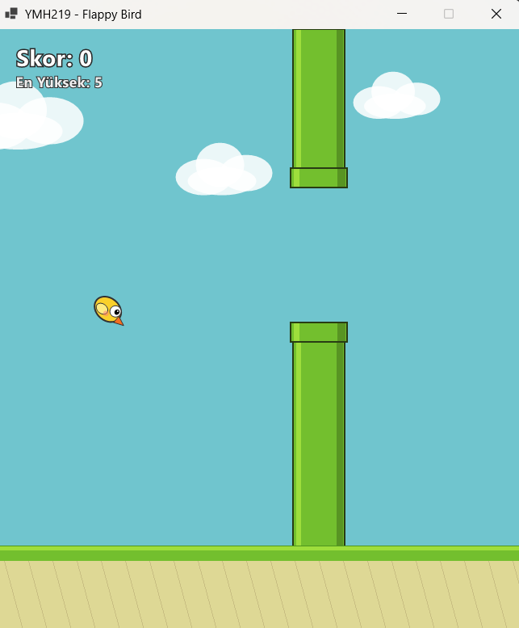
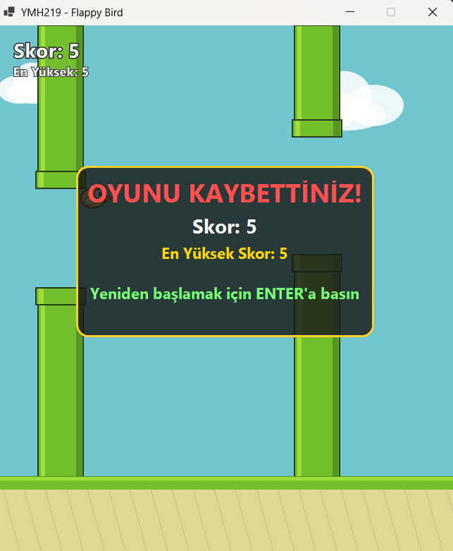

# YMH219 - Flappy Bird Masaüstü Oyunu

Bu proje, **YMH 219 Nesne Tabanlı Programlama** dersi kapsamında geliştirilmiş, Windows Forms ve C# (.NET 10.0) tabanlı bir Flappy Bird masaüstü oyunudur.

---

## 🚀 Proje Amacı ve Açıklaması
Bu uygulamanın amacı; Windows Forms üzerinde zamanlayıcı (`Timer`), klavye olayları (`KeyDown`), nesne tabanlı programlama (OOP) prensipleri ve çarpışma algoritmaları kullanılarak akıcı bir 2D oyun simülasyonu gerçekleştirmektir.

---

## 🛠️ Kullanılan Teknolojiler
- **Programlama Dili:** C# 13 / .NET 10.0
- **Platform:** Windows Forms (WinForms Desktop)
- **Grafik & Çizim:** GDI+ (Gelişmiş Çift Tamponlama - `DoubleBuffered`)
- **IDE:** Visual Studio 2022 / 2026
- **Versiyon Kontrol:** Git & GitHub

---

## 📦 Kurulum ve Çalıştırma Adımları
1. Bu repository'yi bilgisayarınıza klonlayın veya indirin.
2. Visual Studio ile `YMH219-FlappyBird.slnx` çözüm dosyasını açın.
3. Çözümü derleyin (**Build > Build Solution** veya `Ctrl+Shift+B`).
4. **F5** tuşuna basarak oyunu başlatın.

---

## 🎮 Uygulamanın Temel Özellikleri ve Kontroller
- **Kontroller:**
  - `SPACE` (Boşluk): Kuşu yukarı zıplatır.
  - `ENTER`: Oyun bittiğinde oyunu yeniden başlatır.
- **Fizik & Yer Çekimi:** Kuş her karede yer çekimi ivmesiyle aşağı düşer; zıplama tuşuyla dikey hız negatif yönde tetiklenir.
- **Dinamik Engeller:** Ekranda sağdan sola kayan 2 çift boru bulunur. Her boru ekrandan çıktığında hem dikey pozisyonu hem de **iki boru arasındaki boşluk (`Gap`) rastgele yenilenir**.
- **Skor & Rekor Sistemi:** Kuş boruları başarıyla geçtikçe skor 1 artar. En yüksek skor (`HighScore`) kalıcı olarak yerel `highscore.txt` dosyasına kaydedilir ve oyun kapatılıp açılsa bile korunur.
- **Akıcı Çizim (60 FPS):** `DoubleBuffered` aktif edilerek GDI+ ekran titremeleri (flickering) tamamen engellenmiştir.

---

## 🏗️ Nesne Tabanlı Tasarım (OOP) Mimarisi
Proje modüler sınıflarla tasarlanmıştır:
- **`Bird.cs`**: Kuşun koordinatlarını, düşüş hızını, yer çekimini, sınır kutusunu (`Bounds`) ve GDI+ çizimini yönetir.
- **`Pipe.cs`**: Üst/alt boruların genişlik, yükseklik ve değişken aralıklarını (`Gap`) yönetir; kuş ile dikdörtgen kesişim çarpışma testini (`CollidesWith`) gerçekleştirir.
- **`GameManager.cs`**: Oyun durumlarını (`WaitingToStart`, `Playing`, `GameOver`), skor artışını ve dosya tabanlı en yüksek skor okuma/yazma işlemlerini yürütür.
- **`Form1.cs`**: Giriş olaylarını dinler, oyun döngüsünü (`Timer`) işletir ve bileşenleri ekrana render eder.

---

## 📸 Ekran Görüntüleri

### Oyun İçi Oynanış

### Oyun Bitti (Game Over) Ekranı

---

## ⚠️ Bilinen Sınırlamalar / Geliştirme Notları
- Oyun sabit çözünürlüklü (650x750) pencere modunda en iyi deneyimi sunacak şekilde ölçeklenmiştir.
- Gelecek versiyonlarda ses efektleri ve farklı zorluk seviyeleri eklenebilir.

---

## 👤 Öğrenci Bilgileri
- **Ad Soyad:** [Ecenur Üner]
- **Öğrenci No:** [250541078]
- **Ders:** Nesne Tabanlı Programlama 